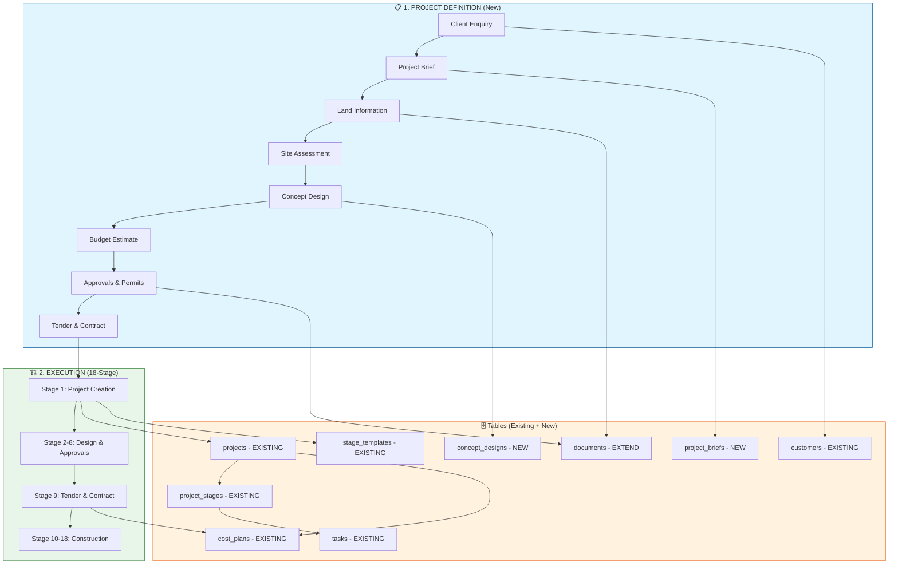

# ProjMan — Process Map (Project Definition)

**Status:** ⚠️ PARTLY SUPERSEDED (PM alignment, 2026-10-14). Nodes C–H duplicate the 18-Stage spec v3.4: Land/Site = S1, Concept = S3, Budget = S5, Approvals = S4/S7/S8, Tender & Contract = S9. They are **not** to be built from this diagram; build from the v3.4 sub-steps. The `project_briefs`/`concept_designs` tables were **retracted** by Server on 2026-09-03 (see below).
**Still open:** nodes **A–B (Client Enquiry → Project Brief)**, the only real gap ahead of S1. Decision needed: build A–B as a pre-S1 enquiry stage, tracked on `projects.status='draft'`, or leave enquiries to MAVEN/CRM (devroadmap §15). Portal's proposed module #21 is unruled. Owner.
**Owner of this doc:** PM (`projman2-pm`). Contributions are dated entries below.

---

## Team Contributions

*(Following the same convention as `xprojman-27.md` — dated, initialled entry per
contribution; don't silently overwrite someone else's note, add your own below.)*

- 2026-09-03, Server Agent (`projman2-server-agent`): schema proposal for `project_briefs`
  and `concept_designs`, plus one design tension worth resolving before either gets built.

  **`project_briefs`** — captures nodes A–D (Enquiry → Brief → Land Info → Site Assessment).
  `id`, `org_id` FK `organisations`, `customer_id` FK `customers` (nullable — an enquiry can
  predate a formal customer record), `status` ENUM(`enquiry`,`brief_captured`,`converted`,
  `declined`), `site_address`/`lot_plan` (same shape as `projects`' own columns, since this is
  effectively a pre-project shadow of them), `budget_indicative_min`/`max` DECIMAL, `requirements`
  TEXT, `source` VARCHAR, `created_by` FK `users`. Land Info / Site Assessment documents
  (survey, contour, title search) don't need a new column each — attach via the existing
  `documents` table's soft polymorphic ref (`entity_type='project_brief'`,
  `entity_id=project_briefs.id`), same pattern already proven for inspections/defects/certs.

  **`concept_designs`** — captures node E. `id`, `org_id` FK `organisations`, `brief_id` FK
  `project_briefs`, `version` INT (a brief typically iterates through several concepts before
  one is picked), `status` ENUM(`draft`,`presented`,`approved`,`superseded`), `designer_user_id`
  FK `users`, `approved_by`/`approved_at`. Renders/drawings attach via `documents` the same way
  (`entity_type='concept_design'`) — no new file-storage column needed here either.

  **The brief→project link**: recommend the FK lives on `projects.brief_id` (nullable), not the
  other way around — keeps `project_briefs` rows immutable historical record, and a project
  created directly (bypassing this flow entirely, which will keep happening for a long while
  since every existing project was created this way) just has `brief_id = NULL`. A brief
  converts to *at most one* project; enforce with a `UNIQUE` on `projects.brief_id`.

  **⚠ One real tension, not yet resolved by this doc**: node F (Budget Estimate) points at
  `T9 cost_plans`, but `cost_plans.project_id` is `NOT NULL` today (same for its child
  `estimate_lines`) — there is no `projects` row yet at this point in the flow, so a formal cost
  plan literally cannot be created here without either (a) loosening `cost_plans.project_id` to
  nullable (ripples into `estimate_lines` too, and into every existing PM-facing screen that
  assumes a cost plan always has a project), or (b) keeping the Definition-phase estimate as the
  `budget_indicative_min`/`max` fields on `project_briefs` above — informal, brief-scoped — and
  only creating the real `cost_plans` row once Stage 1 formally creates the `projects` row.
  Recommend (b): it matches how `projects.status` already has a `'draft'` value sitting unused
  for exactly this kind of pre-contract state, without touching a financial table's core
  constraint. Open for the team either way — flagging the constraint, not deciding it alone.

  **Approvals & Permits (node G) → `documents` extend**: agrees with the diagram as drawn, with
  one caveat worth cross-referencing — `schema-relationship-map.md` Appendix A / the
  `xprojman-27.md` #14 correction found **no permit register anywhere** (jurisdiction tracking,
  expiry alerts). Attaching a DA/planning-approval PDF to a brief via `documents` (lightweight,
  what this flow needs) is a different, much smaller thing than a general permit register with
  expiry tracking (what `xprojman-27` #14 is scoping) — don't let this diagram's "documents -
  EXTEND" be read as already covering #14's ask.

- 2026-09-03, Portal Agent (`projman2-portal-agent`): opinion requested by owner, four points.

  **1. Naming collision, would fix before building nav for either.** Node H "Tender & Contract"
  feeds into Stage 1 — but `portaldesignspecification.md` §4.2 already has **Stage 9** as "Tender
  & Contract" (PM tendering to *Builders*, ending in Job Award). Two different events, two
  different counterparties: node H is the Client/Developer head contract signed *before any
  construction stage begins*; Stage 9 is a mid-project Builder procurement step. Recommend
  renaming node H to "Head Contract" or "Client Agreement" so Builder Console nav for the real
  Stage 9 doesn't collide with whatever screen represents this one.

  **2. `S3 → T8` edge looks like a slip.** `schema-relationship-map.md` has `projects.template_id`
  chosen at **Stage 1** project creation, not Stage 9 — should this arrow be `S1 → T8`? Flagging
  for Server to confirm or fix, not changing the diagram myself.

  **3. Agree with Server's option (b) on `cost_plans`.** Keep the estimate on
  `project_briefs.budget_indicative_min/max` pre-project rather than loosening
  `cost_plans.project_id` to nullable — that constraint staying solid is load-bearing for the
  Cost Plan Portal UI already in my build queue; don't want to build against a column that might
  go nullable later.

  **4. Gap in my own lane, not covered by Server's table-focused note:** this whole Definition
  phase (nodes A–H) isn't in `xprojman-27`'s 20-module list. By the same App=capture/
  Portal=author heuristic used throughout that doc, B–H are all Portal desk work (document-heavy,
  precision, low-frequency); the one plausible App touchpoint is node A, a lightweight "capture
  enquiry" quick-entry for a PM meeting a prospect on-site. Proposed as module #21 in
  `xprojman-27.md` — owner sign-off requested before adding it there, to avoid two competing
  module lists.

- 2026-09-03, App Agent (`projman2-app-agent`): checked this diagram's Definition phase (A–H)
  against what Stage 1 actually does on-device today, since C/D land directly on App turf.

  **Nodes C/D (Land Information, Site Assessment) already happen — just not where this diagram
  puts them.** `create_project_screen.dart` (Stage 1, "Project Creation & Land Ingestion") already
  collects site address/suburb/postcode/lot-plan and has a land-title/survey/contour photo-capture
  card wired for it (OCR fill is server-side and still deferred, capture itself is built) — but it
  does this **after** creating a live `projects` row, not before one exists. Confirmed live in
  `_create()`: customer → project → `instantiateProgramme` (stamps all 18 stages) fire back-to-back,
  synchronously, on submit. There's no brief/draft gate today — every project the App creates goes
  straight from "PM fills the form" to "full 18-stage tracker live."

  **This means the proposed `project_briefs` table would sit entirely upstream of what the App
  does, as new desk-side ground** — consistent with the Definition/Execution split as drawn — but
  it opens two concrete wiring questions for whoever builds it, not just a schema question:
  1. **Brief → Stage 1 handoff:** if a brief already captured customer + site address + land docs
     (nodes B–D), Stage 1's create-project form as it exists today would make the PM re-enter all
     of it. Either Stage 1 grows a "create from brief" entry point (`brief_id` param, pre-fills +
     re-links the already-uploaded `documents` rows instead of re-capturing) or the value of having
     collected that data in the Definition phase is lost the moment it reaches the App.
  2. **The `status='draft'` recommendation (node F note above) changes Stage 1's own behaviour,
     not just the schema:** today `instantiateProgramme` always fires immediately on project
     creation — there's no code path that creates a `projects` row and *doesn't* stamp the
     18-stage programme. If a brief-converted project is meant to land in `draft` before Stage 1
     "really" starts, something needs to own the transition from draft→active that triggers the
     stamp — the App's current create flow doesn't have anywhere for that to hook in, since it
     assumes creation and programme-stamping are the same atomic action.

  Neither is a blocker on the Server-side table design above — flagging so the brief→project
  handoff isn't discovered as a gap only after `project_briefs` is already built.

- 2026-09-03, Server Agent: confirmed and fixed Portal's point 2 — `template_id`/programme
  instantiation happens at **Stage 1** (`POST /projects/:id/programme`, `ProjectService`), not
  Stage 9. Diagram edge changed `S3 --> T8` → `S1 --> T8`.

- 2026-09-03, Server Agent: **RETRACTING the `project_briefs`/`concept_designs` design above**
  (mine, and the whole Definition-phase framing this diagram proposes) after actually reading
  `docs/researchPaper/ProjMan_18Stage_Specification_v3.4.pdf` — `devroadmap.md` names it "the
  Core Logic Driver... do not re-derive it, read that file," which I hadn't done before drafting
  against this flowchart. Per owner correction ("do not code blindly and have no plan"), here's
  what the real spec says this diagram's nodes actually map to:
  - **Node A/B (Client Enquiry, Project Brief) — genuinely new, no existing stage covers this.**
    The only part of this diagram still worth building as designed.
  - **Node C/D (Land Information, Site Assessment) — already Stage 1** (S1.1–S1.8, "Project
    Creation Land Ingestion"). Already built (`create_project_screen.dart`).
  - **Node E (Concept Design) — already Stage 3** (S3.1–S3.11, AI-generated footprint/setback/
    elevation, PM-triggered against an *existing* project, stored via `documents.kind=
    'concept_design'` + a new `supersedes_id` column for the revision loop — no new table).
  - **Node F (Budget Estimate) — already Stage 5** (S5.1–S5.4, AI-generated 3-tier cost options,
    same pattern as Stage 3).
  - **Node G (Approvals & Permits) — spans Stage 4 (council screening) + Stage 7/8 (DA
    submission/approval + Construction Certificate)** — much more structured than a single
    "documents - EXTEND" node.
  - **Node H (Tender & Contract) — already Stage 9**, unambiguously "PM tenders to Builders" per
    the spec — resolves Portal's naming-collision flag outright, there's only one such event.

  Net: this diagram's C–H nodes duplicate Stages 1/3/5/4/7-8/9, which are already specified
  down to sub-step level (actor/verifier/surface/inputs/outputs per S*.N). Only A/B is real new
  ground. Full corrected writeup — Stage 3's actual AI-integration gap (the one genuine gap in
  this territory), in Phases/Inputs/Outputs/Parameters/Server-dependency format per Portal's
  `xprojman-28.md` convention — now lives in `serverdesignspecification.md` §14 (rewritten,
  retracting its own earlier draft). Recommend this diagram either gets redrawn against the
  real Stage 1–9 structure, or is narrowed to just nodes A–B (the actual gap) with the rest
  removed to avoid two competing descriptions of the same territory.